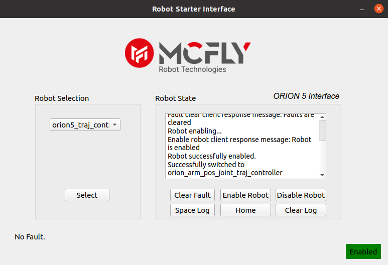
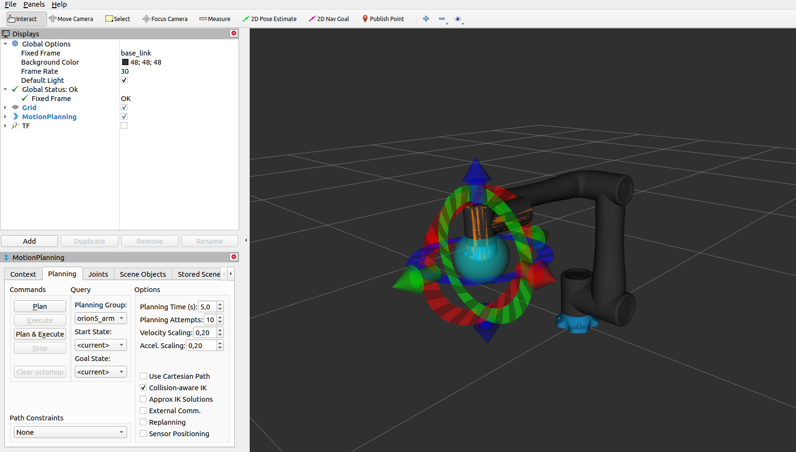
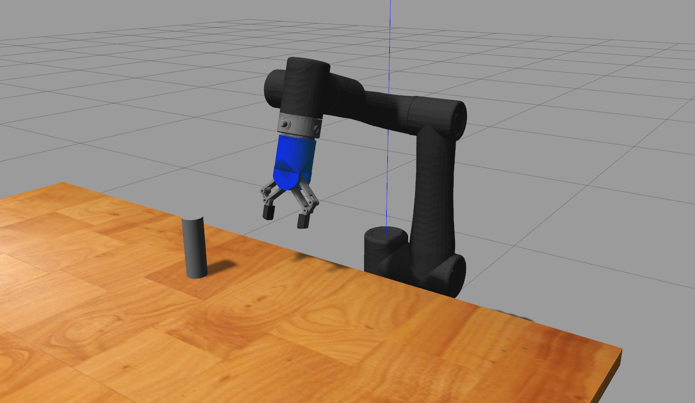

# Orion 5 V1.66 Soem ROS1

Orion 5 V1.66 arm ROS1 Noetic workspace based on SOEM Ethercat Master hardware interface including description, moveit and starting interface packages.

**Last Update Date: 15.11.2024**

Requirements:
---
- Ubuntu 20.04 Focal
- ROS 1 Noetic Desktop Full

Installation:
---
```
sudo apt update
sudo apt install python3-pyqt5
sudo apt install ros-noetic-soem
sudo apt install ros-noetic-ros-control
sudo apt install ros-noetic-ros-controllers
sudo apt install ros-noetic-effort-controllers
sudo apt install ros-noetic-position-controllers
sudo apt install ros-noetic-trajectory-msgs
sudo apt install ros-noetic-controller-manager
sudo apt install ros-noetic-controller-manager-msgs
sudo apt install ros-noetic-robot-state-publisher
sudo apt install ros-noetic-joint-state-controller*
sudo apt install ros-noetic-joint-state-publisher*
sudo apt install ros-noetic-control*
sudo apt install ros-noetic-gazebo-ros*
sudo apt install ros-noetic-gazebo-msgs
sudo apt-get install ros-noetic-moveit
sudo apt-get install ros-noetic-rviz

```

Simulation:
---

Launch robot and ROS controllers on Gazebo:
```
roslaunch orion5_description gazebo_robot.launch
```

Display robot on RViz:
```
roslaunch orion5_description display_robot.launch

```

Connect to the Real Robot:
---

Launch roscore in a seperate terminal first
```
roscore
```
>
> Otherwise, automatic connection and some features of interface will not work !!
>

Change ethernet name in config file in **soem_ros_control > config > soem_config.yaml** (use ```ifconfig -a``` to find the ethernet name)
```
ifname: eth0
```

Launch ethercat master with soem
```
sudo chrt 10 bash
source devel/setup.bash
roslaunch soem_ros_control start_orion5_soem_control.launch
```

Launch Orion interface to enable joints
```
roslaunch orion5_interface orion5_interface.launch
```



Use Moveit to operate the robot
```
roslaunch orion5_moveit_config start_moveit.launch rviz_gui:=true
```




Launch Robot in Gazebo with Gripper
```
roslaunch orion5_description gazebo_robot_mc1.launch
```


